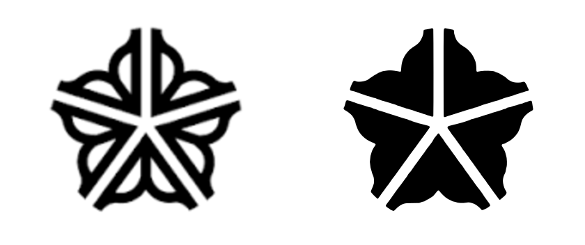

# The parish mark

The site's icon is the **City of Rochester "Flower City" logo, simplified to its
silhouette, behind an Orthodox three-bar cross** — rose on light grey with an ink
cross.



Source of truth is [`public/icon.svg`](../public/icon.svg). Every raster below it is
generated from that file — if the mark changes, regenerate rather than editing a PNG.

## Colours

| role | value | token |
|---|---|---|
| ground | `#E9E9E9` | `--band-light` |
| flower | `#D98A8A` | a rose tint of the parish maroon — **the one colour here not already in the stylesheet** |
| cross | `#212121` | `--ink` |

The cross's shaft is 44px on the 512px canvas. Its arm *lengths* are absolute
constants in the SVG, deliberately: stroke weight can then be tuned without the
crossbar growing wider. Earlier versions tied bar length to a multiple of the shaft,
so thickening the cross also widened it off the edge.

## What ships

| File | Used by |
|---|---|
| `public/icon.svg` | modern browsers (`rel="icon"`, scales to any size) |
| `public/favicon.ico` | 16/32/48 frames, for older browsers and bookmark bars |
| `public/icon-{16,32,48}.png` | the frames the `.ico` is built from |
| `public/icon-180.png` | `apple-touch-icon`, iOS home screen |
| `public/icon-192.png`, `public/icon.png` (512) | the PWA manifest |
| `public/icon-maskable-512.png` | Android adaptive icons — art at 62% so it survives the safe-zone crop |

Linked from `app/views/layouts/application.html.erb`, declared in
`app/views/pwa/manifest.json.erb`.

### Regenerating

Needs `rsvg-convert` and `magick` (`brew install librsvg imagemagick`):

```bash
cd public
for s in 16 32 48 180 192 512; do rsvg-convert -w $s -h $s icon.svg -o icon-$s.png; done
cp icon-512.png icon.png
magick icon-16.png icon-32.png icon-48.png favicon.ico
```

## How the silhouette was made

It is **derived from the city's artwork, not redrawn**. The procedure, in case it ever
needs repeating:

1. Threshold `design/flower-city-logo-source.png` to black and white at 1400px wide.
2. Flood-fill from the image corner. Everything the fill *cannot* reach is either the
   logo's ink or an enclosed interior lobe.
3. Keep exactly that set, and re-trace it with `potrace`.

The result keeps the original's outer contour, all five petal lobes and all five
spines; only the enclosed inner-lobe detail is filled in. Result is
[`design/flower-city-silhouette.svg`](design/flower-city-silhouette.svg).

Two approaches that **do not** work, both tried:

- **Morphological closing.** Dilating to bridge the interior channels also swallows the
  deep notches between the petals, and the mark collapses to a rounded pentagon.
- **An outer hull.** There isn't one. The V-gaps between petals run all the way to the
  centre, so a flood fill from outside reaches the middle of the mark. The logo is
  topologically a five-armed star, not a disc with holes.

## Why it was simplified — the mistake worth not repeating

The first version shipped the *detailed* logo as a watermark: `--maroon-hover`
`#873131` on `--ink` `#212121`. In a live tab the flower was simply not there.

Measured afterwards, that pairing is **1.93:1**, below the 3:1 floor at which a
non-text graphic is considered perceivable. The colour-matrix exploration derived its
watermarks arithmetically and would have caught this; the hand-picked colour bypassed
that check. **Measure the contrast of any future mark before shipping it.**

But contrast was only half the fault, and the more interesting half is the other one.
The detailed logo's interior strokes are roughly **0.7 device pixels** wide at tab
size. No colour makes a sub-pixel stroke visible — it averages into its background no
matter how far apart the two colours are. Brightening the flower helped at 180px and
did almost nothing at 16px.

Note what the current mark actually measures: flower against ground is **2.17:1**,
barely better than the version that failed. It reads clearly all the same, because it
is now a *large solid shape* rather than thin line-work. **Solidity did the work, not
the ratio.** Contrast ratio alone is the wrong instrument for judging a small icon.

[`design/favicon-thickness-study.png`](design/favicon-thickness-study.png) records the
final selection: four ground/flower/cross schemes at three cross weights, each shown
at true 16px and 32px. The chosen one is grey ground / rose flower / ink cross at a
44px shaft. At 34px the cross still greys out when downsampled; at 54px it begins to
cover the petal spines and the flower loses its structure.

## Earlier design history

Five earlier rounds are recorded in
[`design/favicon-evolution.png`](design/favicon-evolution.png):

1. **Generic three-bar crosses.** Rejected — a three-bar cross identifies the faith,
   not the parish, and dozens of Orthodox parishes have essentially that favicon.
2. **Twelve directions cast wide** — wings, the Jordan, a scallop shell, the church
   silhouette, a monogram. The strong idea here is that **St John the Baptist is
   depicted with wings** (the Angel of the Desert, "Behold, I send my messenger before
   thy face"), which is specific to *him* rather than generic to Orthodoxy.
3. **Winged cross, plus a redrawn Rochester flower.** The cross became a genuine
   three-bar here: titulus, centre bar, and slanted footrest with the viewer's-left
   end raised.
4. **The actual Flower City logo**, vector-traced with `potrace`, because an
   approximation of a civic mark is not recognisable *as* that mark.
5. **Watermark + colour study.** Chosen, then found wanting in use — see above.

[`design/favicon-colour-matrix.png`](design/favicon-colour-matrix.png) holds 28
alternative schemes if the palette is ever revisited.

## Provenance, and a thing to know

`design/flower-city-logo-source.png` is the city artwork supplied by Dn Mitch;
`design/flower-city-logo-traced.svg` is the full-detail `potrace` output, and
`design/flower-city-silhouette.svg` the simplified form actually in use.

**The Flower City logo is the City of Rochester's civic identity.** Mitch's judgment
was that the city uses it broadly and tolerates wide local use — it appears on
storefronts, bumper stickers and merchandise around Rochester — and that the parish is
fine on this basis. That is a reasonable read and it is his call to make. It is
recorded here so nobody re-opens the question from scratch, and so whoever fields a
question about it knows the answer was considered rather than overlooked.

If the parish ever wants a mark with no third-party component, round 2's **winged
cross** is the fallback already drawn: distinctive to St John the Baptist, owing
nothing to anyone.
