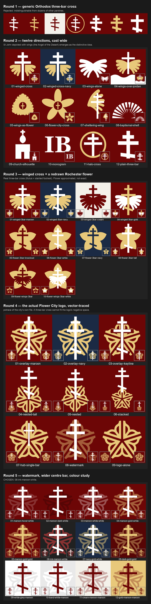

# The parish mark

The site's icon is the **City of Rochester "Flower City" logo, used as a watermark
behind an Orthodox three-bar cross**, in white and `--maroon-hover` on `--ink`.



Source of truth is [`public/icon.svg`](../public/icon.svg). Every raster below it is
generated from that file — if the mark changes, regenerate rather than editing a PNG.

## What ships

| File | Used by |
|---|---|
| `public/icon.svg` | modern browsers (`rel="icon"`, scales to any size) |
| `public/favicon.ico` | 16/32/48 frames, for older browsers and bookmark bars |
| `public/icon-{16,32,48}.png` | the frames the `.ico` is built from |
| `public/icon-180.png` | `apple-touch-icon`, iOS home screen |
| `public/icon-192.png`, `public/icon.png` (512) | the PWA manifest |
| `public/icon-maskable-512.png` | Android adaptive icons — art shrunk to 62% so it survives the safe-zone crop |

Linked from `app/views/layouts/application.html.erb` and declared in
`app/views/pwa/manifest.json.erb`.

### Regenerating

Needs `rsvg-convert` and `magick` (`brew install librsvg imagemagick`):

```bash
cd public
for s in 16 32 48 180 192 512; do rsvg-convert -w $s -h $s icon.svg -o icon-$s.png; done
cp icon-512.png icon.png
magick icon-16.png icon-32.png icon-48.png favicon.ico
```

## Why this mark

The first attempt was a plain Orthodox three-bar cross, and it was rejected for a
good reason: **a three-bar cross identifies the faith, not the parish.** Dozens of
Orthodox parishes have essentially that favicon. An icon's whole job in a tab strip
is to be told apart from its neighbours.

So the mark has to say *Rochester*, or *John the Baptist*, or both. Five rounds of
exploration are recorded in [`design/favicon-evolution.png`](design/favicon-evolution.png):

1. **Generic three-bar crosses.** Rejected — not distinctive.
2. **Twelve directions cast wide** — wings, the Jordan, a scallop shell, the church
   silhouette, a monogram. The strong idea here is that **St John the Baptist is
   depicted with wings** (the Angel of the Desert, from "Behold, I send my messenger
   before thy face"), which is specific to *him* rather than generic to Orthodoxy.
3. **Winged cross, plus a redrawn Rochester flower.** Two fixes landed here: the
   cross became a genuine three-bar (titulus, centre bar, and slanted footrest with
   the viewer's-left end raised), and the flower was drawn from scratch.
4. **The actual Flower City logo**, vector-traced with `potrace` from the city's own
   artwork, because an approximation of a civic mark is not recognisable *as* that
   mark — which was the entire point of using it.
5. **Watermark + colour study.** The watermark composition won; the centre bar was
   widened from 6.8× to 8.6× the shaft width so the cross still reads at 32px.

### The constraint that decided the composition

The logo's negative space was measured directly: the corridor down the top petal's
spine is only ~20px wide at a 512px canvas, and the central hub opens to ~129px on a
single row. **A three-bar cross cannot be nested inside the logo** — a shaft fits, but
the titulus has nowhere to go. So the two elements either overlap or sit apart.
Dropping the logo to a watermark resolves it: the logo stays whole and recognisable,
and the cross reads cleanly in front.

### What small sizes cost

At 32px the mark still reads as a three-bar cross. **At 16px the flower is gone** —
it survives only as texture. That is inherent to the logo's line weight at tab size
and no colour choice fixes it. The decision was made with that understood: the 16px
icon is "dark tile, white cross", and the flower does its work everywhere larger.

The `--ink` ground was chosen partly for this. It reads as a dark tile on a light
browser tab bar and merges into a dark one, so the white cross carries the mark in
both.

## Colours

All from `app/assets/stylesheets` — no new colour enters the parish palette:

- ground `--ink` `#212121`
- flower `--maroon-hover` `#873131`
- cross `--white` `#FFFFFF`

Gold (`#E8C87A`) appears throughout the exploration sheets. It is **not** a parish
colour; it was introduced during this exercise and deliberately not adopted.
[`design/favicon-colour-matrix.png`](design/favicon-colour-matrix.png) holds 28
alternative schemes if the choice is ever revisited. Note the matrix derives its
watermark arithmetically (cross colour at 32% over the ground), so its `ink`/`white`
cell shows a *grey* flower and is **not** the shipped mark.

## Provenance, and a thing to know

`design/flower-city-logo-source.png` is the city artwork supplied by Dn Mitch;
`design/flower-city-logo-traced.svg` is the `potrace` output taken from it. The paths
in `public/icon.svg` come from that trace, so the flower is the city's exact shape,
not an approximation.

**The Flower City logo is the City of Rochester's civic identity.** Mitch's judgment
was that the city uses it broadly and tolerates wide local use — it appears on
storefronts, bumper stickers and merchandise around Rochester — and that the parish
is fine on this basis. That is a reasonable read and it is his call to make. It is
recorded here so that nobody re-opens the question from scratch, and so that whoever
fields a question about it knows the answer was considered rather than overlooked.

If the parish ever wants a mark with no third-party component, round 2's **winged
cross** is the fallback already drawn: distinctive to St John the Baptist, owing
nothing to anyone.
